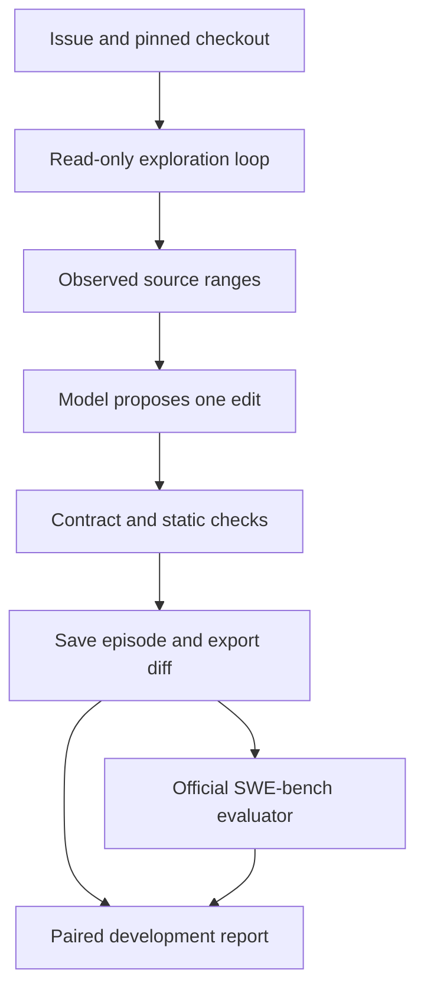

# PatchScope engineering and interview guide

## 1. What the project does

PatchScope studies a specific question. **Does changing what a coding agent can see or how it expresses an edit improve its ability to repair a bug under the same budget?** It provides a Python agent loop, controlled inputs, a constrained repair interface, and records that let an engineer locate the stage where a run failed. It has a trusted-fixture track for local experiments and a SWE-bench Lite development track for historical public issues.

A successful episode can mean three different things. A **validated proposal** satisfies PatchScope's edit contract. An **exported prediction** contains a diff that passed a Git preflight check against the pinned checkout. An **officially resolved issue** passed the separate SWE-bench evaluator. The system keeps all three distinctions because an increase in usable patches can coexist with zero improvement in correct fixes.

## 2. Architecture at a glance



| Responsibility | Code to read | What to look for |
|---|---|---|
| Prepare benchmark task | [swebench_dev.py](../patchscope/swebench_dev.py) and [run_swebench_dev.py](../scripts/run_swebench_dev.py) | Select the development task, project public fields, clone the pinned commit, and verify it before sending requests. |
| Control an episode | [agent.py](../patchscope/agent.py) | `run_episode`, the injected client, bounded exploration, proposal phase, error handling, and episode records. |
| Parse and dispatch tools | [protocol.py](../patchscope/protocol.py), [navigation.py](../patchscope/navigation.py), and [tools.py](../patchscope/tools.py) | Native tool schemas, decoded arguments, path restrictions, and bounded source excerpts. |
| Vary initial evidence | [interventions.py](../patchscope/interventions.py), [context.py](../patchscope/context.py), and [retrieval.py](../patchscope/retrieval.py) | The same task presented with different context conditions. |
| Validate the edit | [proposal_contract.py](../patchscope/proposal_contract.py), [static_review.py](../patchscope/static_review.py), and [repair.py](../patchscope/repair.py) | Exact fragment versus observed line range, source hash, syntax and binding checks, and trusted-fixture execution. |
| Preserve and compare results | [report_swebench_dev_pair.py](../scripts/report_swebench_dev_pair.py) and [the paired protocol](../SWE_BENCH_DEV_PAIRED_REPORT.md) | Match records by issue, check recorded settings, separate export and grade, and retain missing outcomes. |

### How the agent is built

**It is a hand-written Python agent loop. LangGraph was not used.** The model connection is an injected OpenAI-compatible client. The benchmark entry point constructs the real client. Tests and the offline demo can supply an object with the same `client.chat.completions.create(...)` interface.

1. **Initialize the episode.** Load the issue and repository path, choose an evidence condition, and create the initial messages. Keep the model conversation, tool observations, usage, and structured events in state for this episode.
2. **Explore with native tool calls.** The model returns either structured function calls or a final exploration message. Python validates the call and dispatches to an approved tool, stores the result, and feeds it back into the conversation. The tool schema controls what the model can request. The dispatcher controls what actually happens. Examples include listing source files, searching for a literal, and reading a range.
3. **Stop exploration.** No requested actions, the step limit, or the proposal budget reservation can end exploration. The overall token limit is soft because usage is observed after each request. The harness has distinct limits for steps, tool calls, model calls, and completions.
4. **Ask for a patch.** Start a separate proposal conversation containing the issue and observed source. The v0.9 proposal requests one Python file, a one-based inclusive line range, and replacement text. The model emits JSON. This response is handled as data by Python. A contract rejection can trigger a bounded correction request. A later static review rejection happens after that retry loop.
5. **Validate and export.** Check path, types, range, observation, and original source. Build a unified diff in memory. In the benchmark path, persist the episode and run `git apply --check` as a preflight before writing the prediction. The official grader performs application and testing in its own run. For trusted local fixtures, pytest can run against a temporary copy with explicit execution opt-in. The copy is a workspace isolation mechanism. It provides no process or network isolation.

This qualifies as an agent because the next observation depends on the model's previous action. Python controls the possible actions, budgets, transition to proposal, and verification. A plain completion would make one call and return text with no such feedback loop.

### Evidence and comparison

- **Native** begins with the issue text and lets the model discover source. The external development manifest uses this condition.
- **BM25** ranks eligible Python files using lexical overlap with the issue and seeds bounded excerpts. It offers an inspectable baseline that requires no embedding model.
- **Placebo** selects genuine repository code from a curated unrelated pool and tries to match the rendered seed size. **Misleading** uses genuine plausible code from the wrong implementation locus. These conditions test whether relevance or an apparently credible cue changes behavior.
- **Oracle** injects known relevant paths as an experimental control in labeled fixtures. An oracle run that succeeds shows the intervention helped under those settings. An oracle run that fails leaves several explanations open, including misunderstanding, budget, or edit representation.
- Some experimental manifests add a static source map or an opt-in runtime trace of a public reproducer. The SWE-bench development arm leaves both policies off. Frozen replay reuses recorded observations for a later proposal experiment. This can isolate proposal-time changes. A full rerun also allows exploration and tool use to change.

The paired report compares the same task across arms and checks recorded commit, issue hash, model generation settings, budgets and condition where available. It cannot verify that a mutable model name refers to identical weights. Record the model build or digest and evaluator revision separately. An unknown grade stays unknown. A stored episode that terminated without exporting contributes a non-resolution, while an absent episode remains missing.

## 3. Hurdles and what we learned

| Hurdle | Evidence | Response and trade-off |
|---|---|---|
| The target lives outside a source prefix | The basic read returns a bounded prefix. Requesting the same path again can return the same evidence. | Add literal search and targeted line reads in the opt-in navigation policy. Predictable bounds reduce context use. Literal search still depends on the query and the scan limits. |
| Exploration consumes the budget needed for proposal | Five of the 23 historical development issues ended with a soft token budget event. | Reserve a portion of the budget and bound exploration separately. A bigger reserve can leave more capacity for the patch while stopping search earlier. Usage arrives after each call, so the reserve cannot guarantee an exact ceiling. |
| An exact edit is ambiguous | Seven historical runs ended with `patch_old_not_unique_in_observed`. The string could appear in more than one place. | Use line coordinates tied to the observed source. This resolves positional ambiguity. An agent can still choose the wrong observed line or implement the wrong behavior. |
| Malformed model answers and tool calls | Two historical cases ended with invalid or missing proposal JSON. One ended with a tool protocol error. | Decode and validate the calls, record structured failure reasons, and allow a bounded format correction for proposal rejection. Retrying consumes budget and adds a decision point. |
| Valid JSON can express a bad patch | A schema says nothing about Python syntax or whether removal of a name leaves an obvious dangling reference. | Add a small AST gate for syntax and a removed-binding heuristic. Python name resolution is richer than the heuristic. This gate can reject a valid edit or miss a semantic bug. |
| Accepted patches can fail the task | The eight v0.8 exports passed preflight. Preflight cannot show that the repaired program behaves correctly. | Keep export and official resolution as separate outcomes. Report application evidence and grader errors independently where available. |
| New code can invalidate old comparisons | Changes in model builds, prompts, tool limits, task selection, and grader builds can all change outcomes. | Use a separate experiment identifier and preserve the original contract. Treat the 23 familiar tasks as a development screen and reserve untouched cases for generalization. |

The historical counts are terminal outcomes. They should not be read as exclusive causal labels for why a whole task failed. The complete task list and historical export breakdown are in the [v0.8 baseline](../reports/swebench-lite-dev-v08-baseline.md).

### Why an observed line range and a hash?

With the earlier `path/old/new` contract, a line such as `return x - y` appearing twice is ambiguous. With the new contract, the model can say “replace line 5 in calculator.py.” PatchScope loads that range, verifies that its complete content matches observations from the same coordinates, and computes SHA-256 over the **selected original text**. The model supplies no digest. Before materializing the edit, PatchScope derives the selected text again and checks the digest. The benchmark separately pins the checkout commit and checks tracked cleanliness. Range hashing detects changes to the addressed text. It cannot attest to the surrounding semantics.

## 4. Decision log

These entries describe the current design and its engineering rationale. The release notes and code record the behavior. Where an alternative was not benchmarked head-to-head, the rationale is a design trade-off.

| Decision | Why we chose it and what we traded away | Revisit when |
|---|---|---|
| Keep orchestration in Python | The current workflow has a bounded loop followed by proposal, validation, and export. Explicit control flow and client injection make the phases easy to test and to inspect in a debugger. LangGraph could organize branching, checkpoint/resume, or human approval in a larger graph. The current design owns its own instrumentation and restart behavior. | Episode-level restarts become costly or a real branching/resume requirement appears. Prototype the same small workflow before migrating. |
| Separate investigation and proposal | Exploration can use tools and collect evidence. The proposal call receives a narrow input and must produce the edit object. A single unrestricted agent would offer more flexibility and make it harder to locate where a failure happened. The split also adds a model call and can discard useful exploration reasoning. | Matched experiments show that extra context or iterative patch testing improves correctness enough to justify the cost. |
| Restrict the first editor to one observed Python edit | The narrower scope makes ambiguous matches, unseen ranges and malformed proposals visible. Broad, multi-file workspace edits would cover more bugs and widen the set of behavior we must validate. | Applied-but-failing cases show a recurring need for coordinated edits across files. |
| Preserve the legacy contract and pin experiment settings | Existing outputs stay interpretable while v0.9 becomes a versioned intervention. Replacing the default everywhere would contaminate replay comparisons. Maintaining two contracts costs tests and documentation. | The baseline has been archived and evidence supports retiring it from normal runs. |
| Keep benchmark evaluation separate | The agent sees a public issue and pinned source. Scoring uses evaluator-only material. This makes provenance easier to reason about and avoids treating an applicable patch as a success. It requires the official evaluator environment for measured results. | Adopt a different evaluator only after demonstrating equivalent input isolation and clearly documenting the score semantics. |
| Build a scripted offline demo for the release | Use the production episode, validator and export path with a tiny local fixture and scripted replies. A live-model demo would require installation, time, and reproducibility controls before a reviewer could see a result. The demo proves wiring and illustrates one failure mechanism. Model performance needs independently graded runs. | The complete matched development runs support a real benchmark walkthrough. |
| Verify the offline demo on every push and pull request | A regression check applies the exported fixture patch to a second checkout and compares its contents with the expected change. It also checks that the original checkout stays clean and that the report marks the export ungraded. The workflow runs without an LLM account or evaluator. This keeps the portfolio demo continuously testable. | Add a separate evaluator job when the team can provision an official benchmark environment and pin its inputs. |
| Test thinking off for proposal generation | On `sqlfluff__sqlfluff-1733`, two proposal calls consumed the full 1,600 completion tokens each and returned zero visible characters in the control. The opt-in run returned 329 visible characters in 105 completion tokens and exported on its first attempt. The exported patch duplicated a decorator and merged a comment. | Check official grades on development issues before changing the default. |
| Preserve the boundary after a replaced range | The first live export selected fully observed lines and still altered the following line by concatenating its text to a replacement missing a final newline. Reject this splice in proposal validation and recheck during materialization. A regression test reproduces the rejection and verifies that the retry can supply a clean replacement. Static review and Git preflight still cover different properties. | If cleanly bounded exports still fail official tests, investigate which repository evidence the model received and whether it identified the correct behavior to change. |
| Preview the file inventory in an opt-in development run | On the SQLFluff case, the boundary-checked retry exported but the target test still failed. The earlier exploration carried a 219-path listing through several calls and reached the reserve after a truncated read. Limit the displayed list while keeping search and read access available. A sorted preview can change which paths attract attention. | Check whether the shorter inventory leads to additional relevant source reads under the same token budget. Evaluate the resulting edits before widening the experiment. |
| Keep the README focused on the project and one executable demo | Readers can understand and try the project before opening experiment notes. The existing README history remains accessible through the prior commit. Older reports and release notes are reachable in the existing tree while their references are reviewed. | Before a public release, inspect the full checkout and classify outdated material by whether anyone still needs its links or instructions. |
| Feed syntax review into the existing proposal retry | Both Astroid #1978 pilot arms returned the original statement without its indentation. The contract retry fixed the newline, and Python's parser rejected the resulting edit. For a syntax failure on the first attempt, return the reported line and the original observed range with indentation intact. Contract and syntax failures share a retry budget. Automatically restoring indentation would have recreated the original line in this case. | A scripted test covers syntax recovery and checks that a contract failure followed by a syntax failure cannot trigger a third attempt. A separate paired run would measure whether feedback improves exports or verified fixes. |
| Return one correction for a malformed ranged read | SQLFluff #1625 put two string-valued line numbers on `read_file` and stopped before proposing a patch. In the opt-in arm, answer that single rejected native call using its original ID and name the correct tool, integer arguments, and 60-line limit. The rejection consumes a tool slot and the next call uses the existing exploration budget. Automatically renaming the tool or coercing the range would hide what the model can handle and could change what code it sees. | The scripted test covers correction, the control's original failure, and a repeated malformed call. The paired report measures whether the next turn reads the same file successfully, then tracks export, official grade, and token cost. |

**Logging rule for future changes.** For each meaningful architecture, benchmark, security-boundary, or release decision, update this table or add a dated entry in the same commit. Capture the problem, observed evidence, alternatives considered, decision, trade-off, verification, and the condition for revisiting it. If work starts from an assumption, label it. Include a plain-English interview takeaway when the decision changes how the system works. Use commit messages for routine changes.

## 5. Learn it by running it

From the repository root, choose a fresh directory. The demo needs Git and Python, with no external model or Docker. It creates a small local repository and writes two episode records and one exported prediction.

```bash
demo_root="$(mktemp -d)/patchscope-demo"
python -m scripts.demo_paired_repair --output "$demo_root"
python -m json.tool "$demo_root/candidate/demo__calculator-1/prediction.jsonl"
git -C "$demo_root/candidate/demo__calculator-1/repo" status --short
```

1. **Before running it**, predict which arm exports and which grade the report shows. The earlier arm should reject the duplicate line. The line-range arm should export and report `ungraded`. The source checkout status should be clean.
2. **Follow one model call through the code.** Open `ScriptedClient.create` in [the demo](../scripts/demo_paired_repair.py). Find the returned `read_file_range` call, the parser in [protocol.py](../patchscope/protocol.py), the tool implementation in [navigation.py](../patchscope/navigation.py), and the tool reply appended to messages in [agent.py](../patchscope/agent.py).
3. **Inspect an episode.** Open the baseline and candidate `episode.json`. Find `proposal_attempts`, `static_review`, `trajectory`, and `proposal_diff`. Explain why the two statuses differ. Identify where the hash first appears and where application is checked.
4. **Run an experiment on a temporary branch.** In `ScriptedClient.create`, use `4 if "start_line" in self.proposal else 5` for the tool request's `end_line`. This shortens only the candidate read. Its proposal still targets line 5. Predict `patch_range_not_fully_observed` for the candidate. Rerun with a fresh output directory and inspect the saved error. Restore the demo after the exercise.
5. **Practice the measurement question.** Explain why the scripted response shows that the new contract can represent this edit and what extra evidence would establish that a real model uses it effectively across fresh issues.

## 6. Interview practice

**One-minute explanation**

> PatchScope is a Python harness for studying how repository evidence and editing tools affect a coding agent. A model explores a pinned repository through bounded read-only tools, then proposes one structured edit. Python checks that the edit targets observed code, validates it, and exports a diff. The official evaluator checks whether the patch resolves the issue. I designed a paired development comparison so export failures, runtime costs, and resolution can be measured separately. One observed problem was repeated code. We introduced observed line ranges tied to source content and built an offline demo that exercises both protocols through the real loop.

You can describe your ownership concretely by naming what you conceived, reviewed, reproduced, validated, and can change. If asked how the repository was implemented, say that you used AI assistance and walk through a decision you can defend with the saved evidence.

**Likely follow-ups**

- **What would a graph framework give you?** Explicit durable state, retry and branching semantics can help more complex workflows. The present Python stages fit in one bounded control flow and support injected clients. I would compare a small migration once resume or branching becomes a measured cost.
- **What does the hash prove?** The addressed text still matches the approved text at materialization. The pinned checkout and recorded observations serve different purposes. None of these verifies behavior.
- **How would you isolate the benefit of the editor?** Pair issues across arms, hold the model, starting commit, tool access, budget and grading fixed, and document native prompt and validation differences. Compare exports and resolutions separately on the same assigned issues. Follow with untouched tasks.
- **Why did you use BM25?** It is a lexical reference point for evidence selection and easy to inspect. An embedding retriever may handle vocabulary mismatch better. The experiment should hold the downstream loop fixed and compare both under the same context budget.
- **What would you build next?** Use the actual v0.9 paired rerun to see where outcomes change. A repeated-fragment reduction supports the editing change. If correct resolutions stay flat, inspect the failures after export before expanding the editor.


## 7. What PatchScope should prove next

The product hypothesis is that a team evaluating a coding agent can use its run records to choose a cheaper or more effective intervention. The useful unit is a paired issue evaluated through the same independent grader. Track the first observed failure stage, patch export, verified resolution, and cost for each arm.

- Treat the ranged-read run as an engineering pilot. SQLFluff #1625 is a known failure and the other three issues come from the earlier development pilot. Report all four assigned issues, including runs that produce no patch. A successful read or export is an intermediate outcome.
- Compare the built-in editor with an established external editor next. Start with the same model, pinned workspaces, public issues and observed source where both interfaces permit it. Record any differences in tool access, prompts, or budgets. Feed both sets of predictions to the same grader, then use a fixed list of fresh issues before making a performance claim.
- Test the diagnostic layer on the external editor's failures. Have a developer use the report to select one intervention and rerun it on fresh issues. Measure both the time to diagnose and the verified outcomes at the recorded cost. If the external editor performs as well under matched conditions, it can replace the built-in editor in the evaluation workflow.

### First external-editor comparison

The tool-call recovery pilot ended with two exports and zero resolved issues in
each arm. The two exports were byte-identical across arms and the official
grader completed both. The feedback advanced SQLFluff to proposal generation,
where the model twice targeted an incompletely observed range. All 7,018 extra
tokens came from that issue. Tool-call recovery stays opt-in.

The next pilot gives Aider 0.86.2 the public issue and the complete tracked
Python source files observed by PatchScope's native explorer. The native
episode and Aider pass share the issue, starting commit, model tag, and file
selection. Aider uses search/replace blocks in a disposable copy. It can edit
multiple regions within one source file. The same static review, Git preflight
and independent grader check the output. The report links the candidate to its
exact native episode by file hash.

This is a workflow comparison. Aider sees complete files, and its prompts and
inference budgets differ. Report native episode time and incremental Aider
time. Aider token usage is unavailable in this report. Use the same four issues
even if a run fails to produce a patch. These issues are distinct from the
four tool-recovery cases and have already appeared in the v0.8 dev run. Treat
any gain as a reason to run a holdout comparison and then isolate edit format
with byte-matched source context.

Interview takeaway. An export confirms a patch is structurally usable.
The grader supplies the evidence that the repair changes the behavior in the
issue. An external editor lets us test whether the problem lies in expressing
the change, in the evidence supplied, or further upstream.

### Diff export preserves the final line

In the first external-editor pilot Aider resolved two issues and the native
editor resolved none. The grader rejected Aider's pvlib patch during
application. Its Astroid patch applied, but the namespace-package test still
failed. The native SQLFluff proposal passed static review and then failed local
Git preflight with a corrupt diff. Keep those three failure stages distinct.

A regression fixture reproduced corrupt native output when a changed line had
no final newline. The renderer now marks unterminated diff lines explicitly
and a test verifies that applying the diff preserves the intended source bytes.
Replay the saved SQLFluff proposal to check whether the same mechanism explains
that case. Verify official resolution independently and keep the original pilot
result with the renderer that produced it.

### Match source between the editing passes

The SQLFluff #2419 replay recovered the saved native edit after diff
serialization was corrected. The official grader verified the replay without
a new model call. The original comparison remains Aider 2/4 and native 0/4.
Marshmallow #1343 is the remaining Aider-only verified fix in that pilot.

This round locks four issues before running either editor: SQLFluff #1517,
pvlib #1606, Astroid #1196, and pydicom #1694. They were outside the two recent
editor and recovery pilots and came from the earlier SWE-bench Lite dev
catalogue. This is a new editor-comparison development panel. It is not a
sealed test set.

Run native exploration once per issue. The native proposer and Aider receive
the same complete tracked source files selected by exploration. Each episode
records a digest of file paths and source bytes, and the report requires equal
digests, the same base and model, and a link to the original native episode.
The source limit is 64 KiB across all selected files. Cases without an
eligible shared snapshot stay in the assigned denominator and are identified
as unavailable for the paired comparison. Line numbering, edit protocols,
and model settings can still differ by arm. Matching source inputs does not
verify what the backend retained after applying its context limit.

Read official resolution first. Report exports and application as intermediate
results. Aider time is incremental to the shared exploration. Keep Aider
experimental until a repeated comparison shows a verified gain worth the
additional work.

### Replay observed excerpts with a separate editing budget

The first matched-source round produced one eligible pair out of four. Three
workspaces exceeded the full-file limit. On the fourth, the native editor hit
its completion cap and had already spent its soft budget when it needed a
retry. Aider exported one patch, which failed grader application.

Reuse the four saved exploration records and the pinned base commits. Verify
complete lines against the recorded tool responses. Prefer recent explicit
range reads over file prefixes and retain one contiguous excerpt per file,
up to three files and 8 KiB total. The native editing pass starts with a fresh
budget and keeps the original line numbers. Aider receives the same excerpts
in a disposable worktree and any resulting edit is spliced into the original
source at the verified coordinates. Review and Git-preflight the resulting
full-file patch before export. The report checks excerpt hashes and official
resolution. A limited excerpt can miss necessary code, and edit protocols
and model settings continue to differ by arm. This is a follow-up on the
existing four issues.

### Post-grading source-window audit

In the four-issue window replay, all four pairs shared an issue, base, model and excerpt snapshot. Native exported zero predictions. Aider exported two, both applied in the official grader and both were unresolved. These outcomes leave two different engineering questions open. Did exploration reach the code used in a known repair? If it did, did the editor receive that code and change its behavior correctly?

The evaluator command `python -m scripts.audit_swebench_windows` joins the original exploration, the two replay episodes, the reference fix from the development split, and the per-issue grader records. It checks the base and the hashes linking those records. It applies the reference to a temporary Git index and measures changed base lines and insertion boundaries. Unchanged diff context would inflate apparent coverage. A source path alone would give credit even when the editor saw the wrong function.

Use the per-location table to choose the intervention. If complete file reads contained a reference change and the editing excerpts dropped it, test retaining more than one observed range per file within the same byte budget. If exploration missed it, inspect issue-driven search and follow-up reads. For fully visible changes, read the submitted diff and failing behavioral checks before changing the editor. Mixed results can warrant different interventions per issue. An alternative implementation can resolve an issue elsewhere, and a visible line does not establish that the editor had all the context it needed.

Keep the resulting reference edits and test names with the evaluator. Use the four cases for retrospective diagnosis. Preselect fresh development issues before evaluating a policy chosen from this report, and use official resolution as the primary outcome.

### Traceback-guided range selection experiment

In the four-issue development audit, the original reads covered 2 of 15 reference edit sites. All 2 survived excerpt selection. Each replay included the reference file. Three missed its edited lines. For Astroid the public traceback's line 2254 even fell inside the excerpt, while the pinned base's existing method was farther down. SQLFluff illustrates the other failure mode. Aider edited the right helper but its handling of trailing semicolons still raised a runtime error for the reported input.

The localization probe keeps each replay file and its individual line and UTF-8 byte limits fixed. For each traceback frame it checks the path suffix, function, and reported source statement against the historical checkout. A unique matching statement can recover from line-number drift. Among eligible frames for a file it prefers a function named before the traceback and then the deeper frame. Unconfirmed frames leave the original excerpt in use. This policy scans files locally and may read more source internally even though the editing input stays bounded.

The probe freezes all proposed windows using only public issue text and repository source before opening development references for scoring. Counts measure coverage of one known implementation, without estimating repair rate. These four issues informed the policy. A change worth testing should recover locations on multiple issues and preserve SQLFluff coverage. The next repair comparison should preselect unused issues and hold the editor, model and budgets constant.

### Paired repair trial on new development issues

The retrospective traceback probe increased coverage from 2/15 to 10/15 reference sites. It recovered six sites in Astroid and two in pvlib and retained both SQLFluff sites. In pydicom it selected a valid downstream traceback frame and still missed the reference edit. We froze that ranking rule before running the repair trial.

All 23 Lite development IDs had already appeared in the v0.8 baseline. The trial takes the full SWE-bench development split, excludes those IDs, filters on the public presence of a Python traceback frame, and orders eligible IDs by a fixed salted SHA-256. The first four IDs and their public task records go into protocol.json before inference. This measures a traceback-bearing subset. Four pairs can reveal concrete failure modes and cannot establish a population-wide performance advantage.

Both arms use the same native editor with qwen3.5:9b, seed, prompts, retry allowance and editing budgets. One normal exploration episode per issue supplies the same saved reads to both arms. Its ordinary proposal is excluded from scoring. The baseline edits the saved windows. The candidate can reposition each window using the frozen policy. The runner alternates arm order and counts every assigned issue, including unchanged windows and missing exports. The report separates changed windows, exports, official grades and paired resolution. Editing totals exclude shared exploration and offline window construction. Use the printed pilot directory as the runner argument to resume a run.

### Reference evidence in paired reports

The pydicom #811 model and benchmark reference produced identical tracked contents. The target test passed in every run, while the same existing filename test failed in each. Preserve the benchmark outcome and expose the evidence needed to choose between agent debugging and environment investigation. The report can now ingest archived evaluator artifacts without another model call or Docker run. Comparing trees on a pinned base handles alternative diff encodings. Independent run directories and patch checks reduce the risk of comparing a prediction with its own grade. Missing grader patch files remain visible. Equal failing test names alone cannot establish a common cause; inspect the traceback for that claim.
